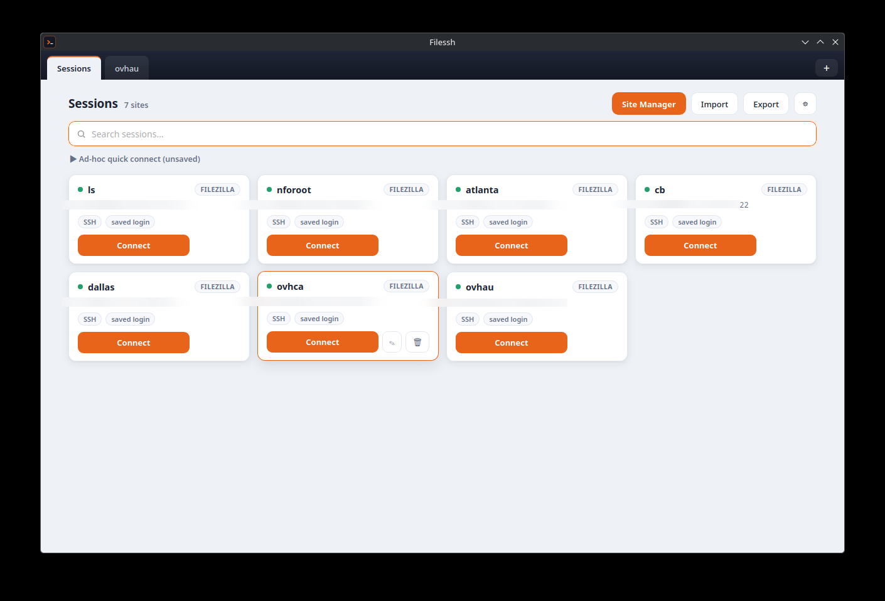
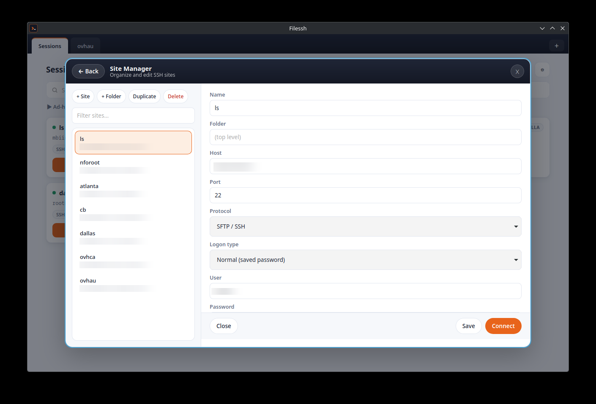
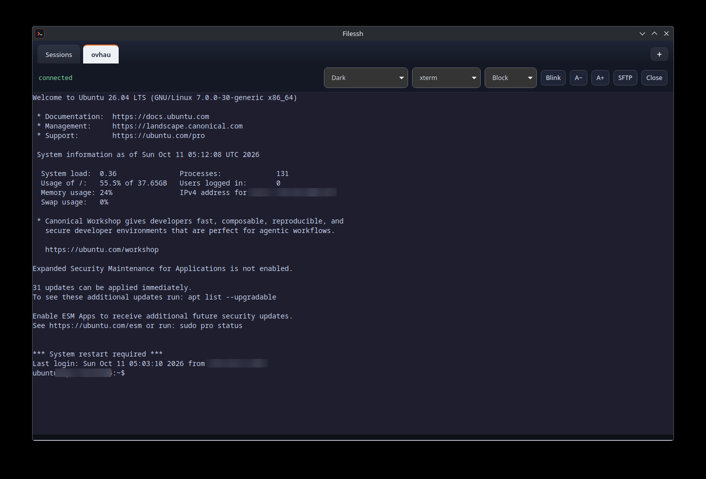

# Filessh — Solar-PuTTY style SSH client for Linux

Tabbed GUI SSH client with FileZilla SFTP import. Ships as Electron **or** Tauri (Rust) with the same GUI.



## Screenshots

| Sessions | Site Manager | Terminal |
|---|---|---|
|  |  |  |

(Session details blurred for the screenshots.)

## Stack — why both, not either/or

> **Paramiko (Python) / `ssh2` (Node) = transport. xterm.js = terminal emulator.**
> You need both: one speaks SSH, the other draws the terminal.

| Layer | Choice in this project | Why |
|---|---|---|
| SSH transport | Node `ssh2` (Electron) / Rust `ssh2` crate (Tauri) | Channels/shell/SFTP, key + password auth, port forwarding |
| Terminal emulation | `xterm.js` + `addon-fit` (vendored in `renderer/vendor/`, shared by both shells) | Full VT100/xterm parsing, colors, ncurses/vim/htop work |
| Shell | Electron (`main.js`) **or** Tauri v2 / Wry (`src-tauri/`) — same GUI | Linux-native; Tauri binary is ~17 MB vs ~108 MB Electron AppImage |

If you insisted on pure Python, you'd still embed xterm.js in a `QWebEngineView` and keep Paramiko only for transport — same split, more glue code.

## Features

- Solar-PuTTY layout: left session tree + search, top tabs, quick-connect bar
- Saved sessions in `~/.config/filessh/sessions.json`, AES-256-GCM encrypted secrets
- SSH password + key-file auth, jump-host/bastion sessions
- StrictHostKeyChecking prompt + known_hosts, with cached host-key-type preference so routine connects stay silent
- Tunnels: Local (`-L`), Remote (`-R`), Dynamic SOCKS (`-D`) forwarding matrix
- SFTP browser panel (list/download/upload) per tab
- 12 interface themes + 15 terminal themes
- FileZilla import: `sitemanager.xml` + `recentservers.xml`
  - Host, port, user, protocol filter (SFTP/SSH only or all)
  - Base64 password decode (Logontype=Normal). Warns on master-password-protected entries
  - Keyfile path carry-over
  - Auto-detects `~/.config/filezilla/` and `~/.filezilla/`


## Settings reference

Per-site (Site Manager → Advanced sections):

- Connection: keep-alive interval / max misses (`ServerAliveInterval`), jump-host/bastion session
- Authentication: key-file picker, encrypted key passphrase, SSH agent forwarding toggle
- Tunnels: Local (`-L`), Remote (`-R`), Dynamic SOCKS (`-D`) forwarding matrix
- X11 forwarding checkbox + display screen
- Crypto: cipher / KEX / host-key algorithm allow-lists (blank = ssh2 defaults)
- Logging: per-session terminal log file (blank = auto `~/.config/filessh/logs/`)

App Settings (File → Settings):

- Interface theme (12 built-in), terminal theme default, TERM emulation, font size, scrollback rows
- Copy-on-select, right-click paste, close-tab confirm
- SFTP initial path, log directory, log-all default, keep-alive + auto-reconnect defaults


## Install

Prebuilt packages live on the [Releases page](https://github.com/Wookiee-/Filessh/releases) (`v0.1.0`):

| Format | File | Notes |
|---|---|---|
| Flatpak | `Filessh-0.1.0.flatpak` | Recommended. `flatpak install --user Filessh-0.1.0.flatpak` — WebKit comes from the shared GNOME runtime |
| Fedora / RHEL | `Filessh-0.1.0-1.x86_64.rpm` | Needs system `webkit2gtk4.1` |
| Debian / Ubuntu | `Filessh_0.1.0_amd64.deb` | Needs system `webkit2gtk4.1` |
| Arch | `filessh-bin-0.1.0-1-x86_64.pkg.tar.zst` | `sudo pacman -U filessh-bin-*.pkg.tar.zst`; also usable as an AUR `-bin` source (see `packaging/arch/PKGBUILD`) |

No AppImage is published: at ~111 MB (bundled WebKit) it buys nothing over the Flatpak.

## FileZilla paths probed

- `~/.config/filezilla/sitemanager.xml`
- `~/.filezilla/sitemanager.xml`
- custom file via Browse button

## Run (dev)

```bash
npm install
npm start          # Electron
npm run tauri:dev  # Tauri (same renderer/, Rust backend)
```

## Release

```bash
npm run dist           # Electron -> dist/Filessh-0.1.0.AppImage (~96 MB, self-contained)
npm run tauri:build    # Tauri -> src-tauri/target/release/bundle/
                       #   Filessh_0.1.0_amd64.deb / .rpm (~5 MB, needs system webkit2gtk4.1)
npm run flatpak:build  # Tauri -> user Flatpak install (webkit via GNOME runtime, no host deps)
flatpak run tech.wookiee.filessh
```

Size notes: the Tauri binary itself is ~17 MB. The Flatpak is the lean distribution path:
WebKit comes from the shared GNOME runtime. The Flatpak sandbox is tightened to
`sessions + FileZilla sources + ~/.ssh` (plus the file portal for key/log pickers);
SSH-agent forwarding has no socket inside the sandbox.

After `Cargo.lock` changes, regenerate `flatpak/cargo-sources.json` with
[flatpak-cargo-generator](https://github.com/flatpak/flatpak-builder-tools/tree/master/cargo):

```bash
python3 flatpak-cargo-generator.py src-tauri/Cargo.lock -o flatpak/cargo-sources.json
```

Publish the Flatpak on GitHub Releases:

```bash
npm run flatpak:bundle   # -> Filessh-0.1.0.flatpak (~3 MB; GNOME runtime comes from Flathub)
gh release create v0.1.0 --title "Filessh 0.1.0" --notes "Tabbed SSH client (Tauri)."
gh release upload v0.1.0 Filessh-0.1.0.flatpak
```

Users install it with:

```bash
flatpak install --user Filessh-0.1.0.flatpak
```

## Tests

```bash
node test/e2e.js                                  # Electron SSH stack vs in-process fake server
npm run test:rust                                 # Rust unit + live round-trip tests (filezilla/csv/crypto/sessions/ssh)
node test/fake-server.js 2222                     # standalone fake SSH server (tester/testpw) for manual testing
```

## Wayland note

On Wayland (e.g. KDE), WebKitGTK's DMABUF renderer can abort with
`Gdk-Message: Error 71 (Protocol error) dispatching to Wayland display`.
The Rust backend sets `WEBKIT_DISABLE_DMABUF_RENDERER=1` in-process when
`WAYLAND_DISPLAY` is present, so no manual env is needed. If you still hit
compositor issues, fall back to XWayland for that run:

```bash
GDK_BACKEND=x11 npm run tauri:dev
```

Window managers associate windows via the `filessh` app-id / `StartupWMClass=filessh`
(see `assets/filessh.desktop`; `npm run desktop:install` installs the dev entry).

## Import test

```bash
node lib/filezilla.js ./sample-filezilla-sitemanager.xml
```
